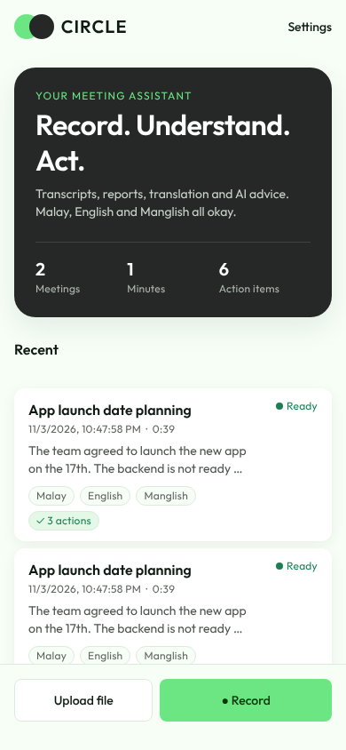
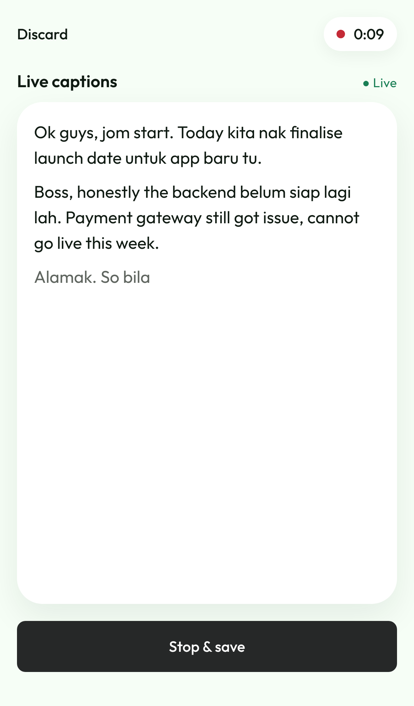
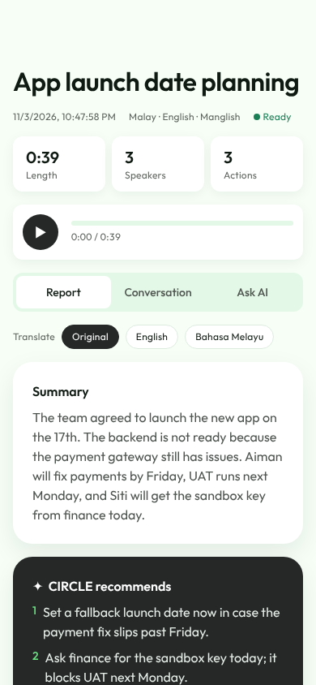
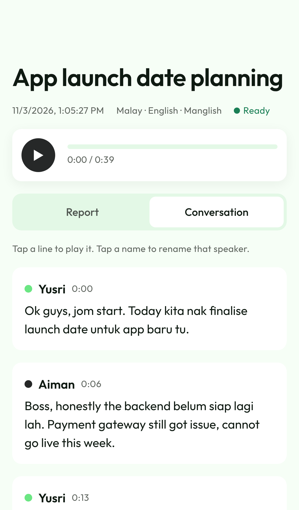

# CIRCLE

Record a meeting on your phone. CIRCLE stores the recording, writes a transcript that shows who said what, and has AI write the report: summary, key points, decisions, action items, and a glossary of slang and dialect words. It handles Malay, English, Manglish and code-switching.

| Home | Live captions | Report | Conversation |
|---|---|---|---|
|  |  |  |  |

## How it works

```
While recording:
Phone app  ──live audio (WebSocket)──▶  server  ──▶  ElevenLabs realtime
           ◀──────── live captions ─────────────────────┘

After you tap Stop & save:
Phone app (Expo)  ──upload audio──▶  CIRCLE server (Node)
                                       │ 1. saves the recording
                                       │ 2. ElevenLabs Scribe: speech-to-text + speaker labels
                                       │ 3. Claude: fixes misheard Manglish/dialect words,
                                       │    writes the report and slang glossary
                  ◀──report + transcript─┘
```

- **`app/`**: the phone app (Android and iPhone from one codebase, built with Expo). Styled from [`docs/design.md`](docs/design.md).
- **`server/`**: the API. It keeps the API keys off the phone, stores recordings and runs the AI steps.

Without API keys the server runs in **demo mode** and returns a sample Manglish meeting, so you can try the whole app for free first.

## iPhone-only setup (free, no computer)

Everything runs online on free plans, and every step works in your iPhone's browser.

| What | Service (free plan) | What it does |
|---|---|---|
| Server | [Render](https://render.com) | Runs the CIRCLE server. Sleeps after 15 minutes unused; the first request after that takes about a minute. |
| Storage | [Supabase](https://supabase.com) | Keeps recordings and reports (1 GB free, about 70 hours of meetings). Free projects pause after a week unused; tap Restore in Supabase to wake it. |
| App | [Expo](https://expo.dev) + Expo Go | GitHub publishes the app to Expo automatically; you open it in Expo Go. |
| Transcription | [ElevenLabs](https://elevenlabs.io) | Free monthly minutes. |
| Reports | [Anthropic](https://console.anthropic.com) | Pay-as-you-go; with Claude Haiku, well under 1 US cent per meeting. |

**1. Storage (Supabase).** Sign up at [supabase.com](https://supabase.com) and create a new project (any name, any password, region Singapore). When it is ready, open **Project Settings** and copy the **Project URL** and the **secret** API key (also called `service_role`). Keep the secret key private. CIRCLE creates its storage folder by itself.

**2. Server (Render).** Sign up at [render.com](https://render.com) with GitHub, then open [this deploy link](https://render.com/deploy?repo=https://github.com/YushAbdullah/circle). Allow Render to see the `circle` repo if asked. Fill in:
- `SUPABASE_URL` and `SUPABASE_SERVICE_KEY` from step 1
- `ELEVENLABS_API_KEY` and `ANTHROPIC_API_KEY` (leave both empty to try demo mode first)

Tap **Apply**. When it says *Live*, copy the service address (`https://circle-server-….onrender.com`). Under **Environment**, copy the generated `APP_TOKEN`.

**3. App (Expo).** Sign up at [expo.dev](https://expo.dev/signup). Open **Account settings > Access tokens**, create a token and copy it. Then in GitHub, open the `circle` repo > **Settings > Secrets and variables > Actions**:
- **Secrets** tab: New secret `EXPO_TOKEN` = the token
- **Variables** tab: New variable `CIRCLE_SERVER_URL` = the Render address from step 2

Open the **Actions** tab > **Publish app to Expo Go** > **Run workflow**. When it finishes (about 3 minutes), open the run; its summary has the link to your app.

**4. Open it.** Install [Expo Go](https://apps.apple.com/app/expo-go/id982107779), sign in with your Expo account, then open the link from step 3 and choose **Open with Expo Go**. In the app's **Settings**, paste the `APP_TOKEN` and tap **Save**.

Every later change pushed to GitHub republishes the app automatically.

## Setup guide

You need a computer for the first run. Install [Node.js 22 or newer](https://nodejs.org) and [Git](https://git-scm.com).

### 1. Get the code

```bash
git clone https://github.com/YushAbdullah/circle.git
cd circle
```

### 2. Start the server

```bash
cd server
npm install
cp .env.example .env     # then edit .env (see below)
npm start
```

You should see `CIRCLE server on http://localhost:4000`. In `.env`:

| Setting | What to put |
|---|---|
| `APP_TOKEN` | Any long random password. The app has to use the same one. |
| `ELEVENLABS_API_KEY` | From [elevenlabs.io](https://elevenlabs.io/app/settings/api-keys). Does the transcription and works out who is speaking. |
| `ANTHROPIC_API_KEY` | From [console.anthropic.com](https://console.anthropic.com/settings/keys). Claude writes the report. |
| `KEYTERMS` | Optional. Names and terms to listen for, e.g. `Yusri,CIRCLE,Petronas,tapau` |

Leave both API keys empty for demo mode.

### 3. Run the app on your phone

1. Install **Expo Go** from the Play Store or App Store.
2. In a second terminal:
   ```bash
   cd app
   npm install
   npx expo start
   ```
3. Scan the QR code with your phone camera (iPhone) or the Expo Go app (Android). Your phone and computer must be on the same Wi-Fi.
4. In the app, open **Settings**:
   - **Server address**: your computer's local IP, e.g. `http://192.168.1.20:4000` (on Windows run `ipconfig`, on Mac go to System Settings > Wi-Fi > Details).
   - **Access token**: the `APP_TOKEN` from `.env`.
   - **Custom words**: names and slang you want recognised.
5. Tap **Record**, then **Start recording**. Captions appear on screen as people talk. Tap **Stop & save**; the recording is stored and the full report with speaker names appears in a minute or two.

Expo Go only records while the app is open on screen. To keep recording with the screen locked, build the real app (step 5).

### 4. Put the server online

**Free option: your laptop + Cloudflare Tunnel.** One command runs the server and gives it a free public `https://` address:

```bash
cd server
npm install
npm run live
```

It prints the **Server address** and **Access token** to type into the app's Settings (it creates `server/.env` with a random token on first run). The app then works from anywhere while this window stays open and the laptop is awake. Recordings stay on your laptop. The address changes each time you run it, so re-enter it in the app.

**Paid option: always on.**

For use away from your Wi-Fi, deploy `server/` to a host with a persistent disk, such as [Railway](https://railway.app), [Render](https://render.com) or [Fly.io](https://fly.io):

- Start command: `npm start`, from the `server` folder.
- Set the same environment variables as `.env`.
- Mount a persistent volume and set `DATA_DIR` to it, so recordings survive restarts.

Then put the `https://…` address in the app's Settings.

### 5. Build the installable app

```bash
cd app
npx eas-cli@latest login
npx eas-cli@latest build --platform android --profile preview   # gives you an .apk to install
npx eas-cli@latest build --platform ios                          # needs an Apple Developer account
```

The installed app expects an `https://` server address (step 4); plain `http://` local addresses only work in Expo Go.

## Dialects and slang

- The transcriber detects the language for each recording instead of forcing one, which suits Malay–English code-switching.
- Live captions expect Malay with English mixed in (`LIVE_LANGUAGE=ms`, `LIVE_SECONDARY_LANGUAGES=en`). Add `zh` or `ta` if your meetings mix in Chinese or Tamil. Live captions have no speaker names; the final transcript does.
- Custom words (in Settings and in `KEYTERMS`) are sent to the transcriber and to Claude.
- Claude corrects words the transcriber clearly misheard but keeps people's original mix of Malay, English and particles like *lah*, *kan* and *meh*. The report itself is in English.
- If a heavy dialect (Kelantan, Terengganu, Sabah) transcribes poorly, the transcriber can be swapped for a Malaysian-tuned Whisper model in `server/src/transcribe.ts` without changing the app.

## API

| Method | Path | Purpose |
|---|---|---|
| GET | `/health` | Server status and whether demo mode is on |
| GET | `/meetings` | List meetings |
| POST | `/meetings` | Upload audio (`audio` file field; optional `title`, `durationSec`, `numSpeakers`, `vocabulary`, `liveText`) |
| GET | `/meetings/:id` | Full meeting: transcript, report, speaker names |
| GET | `/meetings/:id/audio` | Stream the recording |
| WS | `/live?token=…` | Live captions: send 16 kHz mono 16-bit PCM, receive `{type: "partial"\|"final", text}` |
| PATCH | `/meetings/:id` | Rename the meeting or speakers: `{ "title": "...", "speakerNames": { "speaker_0": "Yusri" } }` |
| POST | `/meetings/:id/reprocess` | Rerun the AI report |
| DELETE | `/meetings/:id` | Delete the meeting and its recording |

Every route except `/health` needs `Authorization: Bearer <APP_TOKEN>` when `APP_TOKEN` is set.

## Development

```bash
cd server && npm run typecheck && npm test
cd app && npx tsc --noEmit
```
